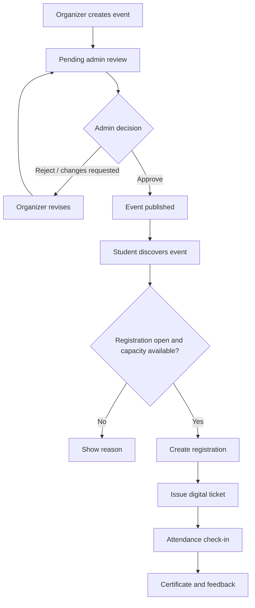

# Product Requirements Document (PRD)
## UniEvent — University Event Management and Registration System

**Version:** 1.0 | **Status:** Proposed 

## 1. Purpose
UniEvent is a web-based platform for centralizing university event discovery, approval, registration, attendance, certificates, announcements, and feedback. This PRD describes product goals, users, scope, features, and success criteria.

## 2. Problem Statement
University event information is often spread across social media, messaging groups, posters, department notices, and separate forms. Students may miss events and updates, while organizers manage registration and attendance manually. Administrators lack one consistent overview of event activity.

## 3. Product Vision
Provide one accessible portal where students discover and join events, organizers manage events and participants, and administrators supervise publishing and platform activity.

## 4. Objectives
- Centralize university event information.
- Enable event search, registration, and registration tracking.
- Help organizers manage participants, announcements, and attendance.
- Provide event approval and user management for administrators.
- Reduce duplicate registrations and manual attendance work.
- Support digital tickets, QR attendance, certificates, feedback, and analytics.

## 5. Stakeholders

| Stakeholder | Main need |
|---|---|
| Student | Discover events, register, receive updates, view tickets/certificates |
| Organizer | Create events, manage participants, record attendance |
| Administrator | Approve events, manage users/categories, review reports |
| University/department | Improve event communication and maintain event records |

## 6. Scope

### In scope
- Public homepage and event listings
- Account registration and login
- Student, organizer, and administrator roles
- Event creation, editing, cancellation, and approval
- Search and filters
- Registration, cancellation, deadline and capacity checks
- Participant lists
- Digital ticket and QR attendance
- In-app notifications and announcements
- Certificates, feedback, dashboards, and basic reports

### Out of scope for the initial release
- Native mobile apps
- Online payments
- Facial recognition
- AI recommendations
- SMS/WhatsApp gateways
- Complex multi-campus administration

## 7. User Roles

| Role | Permissions |
|---|---|
| Student | Browse/search events, register/cancel, view own tickets, notifications and certificates, submit feedback |
| Organizer | Manage own events, view participants, publish announcements, record attendance, issue eligible certificates |
| Administrator | Manage users/categories, approve or reject events, oversee reports and system activity |

Backend authorization is required; hiding buttons in the frontend is not sufficient.

## 8. Main User Journeys

### Student
1. Sign up and log in.
2. Search or filter events.
3. View event details.
4. Register if registration is open and capacity remains.
5. Receive a unique registration reference/ticket.
6. Attend the event and check in.
7. View an eligible certificate and submit feedback.

### Organizer
1. Sign in and create an event.
2. Submit it for admin review.
3. After approval, monitor registrations and send announcements.
4. Record attendance and issue certificates to eligible participants.
5. Review event feedback and statistics.

### Administrator
1. Review pending events.
2. Approve, reject, or request changes.
3. Manage user access and categories.
4. Review system-wide reports.

## 9. Functional Requirements

| ID | Requirement | Priority |
|---|---|---|
| PR-01 | Users can register and sign in securely. | Must |
| PR-02 | Permissions follow user roles. | Must |
| PR-03 | Published events are displayed. | Must |
| PR-04 | Users can search and filter events. | Must |
| PR-05 | Organizers can manage their own events. | Must |
| PR-06 | Admins can approve/reject events. | Must |
| PR-07 | Students can register while registration is open. | Must |
| PR-08 | Duplicate registrations are prevented. | Must |
| PR-09 | Capacity and deadline rules are enforced. | Must |
| PR-10 | Organizers can view participant lists. | Should |
| PR-11 | Confirmed registrations receive a unique ticket/reference. | Should |
| PR-12 | Organizers can record attendance. | Should |
| PR-13 | In-app notifications and announcements are supported. | Should |
| PR-14 | Certificates can be issued to eligible participants. | Should |
| PR-15 | Participants can submit post-event feedback. | Could |
| PR-16 | Dashboards show basic event statistics. | Should |

## 10. Non-Functional Requirements
- **Usability:** Responsive, clear interface on desktop and mobile.
- **Security:** Password hashing and server-side authorization.
- **Privacy:** Users see only information permitted for their role.
- **Performance:** Common listing/search operations should be responsive for expected project usage.
- **Reliability:** Registration and capacity updates must remain consistent.
- **Maintainability:** Frontend, API, and database code are modular.
- **Accessibility:** Readable contrast, keyboard-accessible controls, labelled forms.

## 11. Business Rules
1. Only approved/published events are publicly visible.
2. A student cannot register twice for the same event.
3. Registration is rejected after the deadline or when capacity is full.
4. Cancelled events cannot accept new registrations.
5. Organizers manage only their own events unless granted broader permission.
6. Only admins approve or reject events.
7. Attendance requires a valid registration and is recorded once.
8. Certificate eligibility is checked before issue.
9. Important administrative actions should be logged.

## 12. Success Measures
- A student can register once and view their ticket.
- An organizer can create an event and view participants.
- An admin can approve/reject events.
- Deadline and capacity limits are enforced.
- Students cannot access admin-only APIs.
- Duplicate attendance is prevented.
- Core workflows pass documented test cases.

## 13. Assumptions and Risks

| Risk / assumption | Response |
|---|---|
| Unauthorized publication | Admin approval and backend role checks |
| Overbooking | Transaction-safe registration and database constraints |
| Student data exposure | Least-privilege access and limited public fields |
| QR ticket reuse | Unique token and one-time check-in |
| Scope grows too large | Deliver MVP first; add advanced features in phases |

## 14. Release Plan

| Release | Deliverables |
|---|---|
| MVP | Authentication, roles, event CRUD, approval, search, registration, capacity checks |
| Release 2 | Dashboards, announcements, tickets, attendance |
| Release 3 | Certificates, feedback, analytics, deployment polish |

## 15. Acceptance Criteria
The MVP is acceptable when students can discover and register for published events, organizers can manage events and participants, and administrators can approve events. Duplicate registration, capacity, deadline, and role restrictions must be tested.

## 16. Product Flow Diagram

## 17. Conclusion
UniEvent centralizes event discovery and management. The initial release prioritizes secure roles, approval, search, registration, and capacity rules, followed by attendance, certificates, feedback, and analytics.
