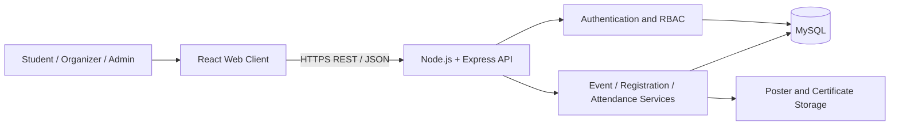
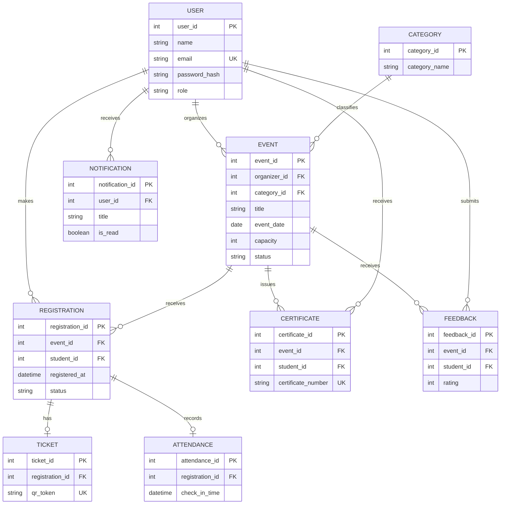
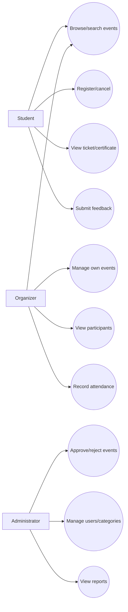
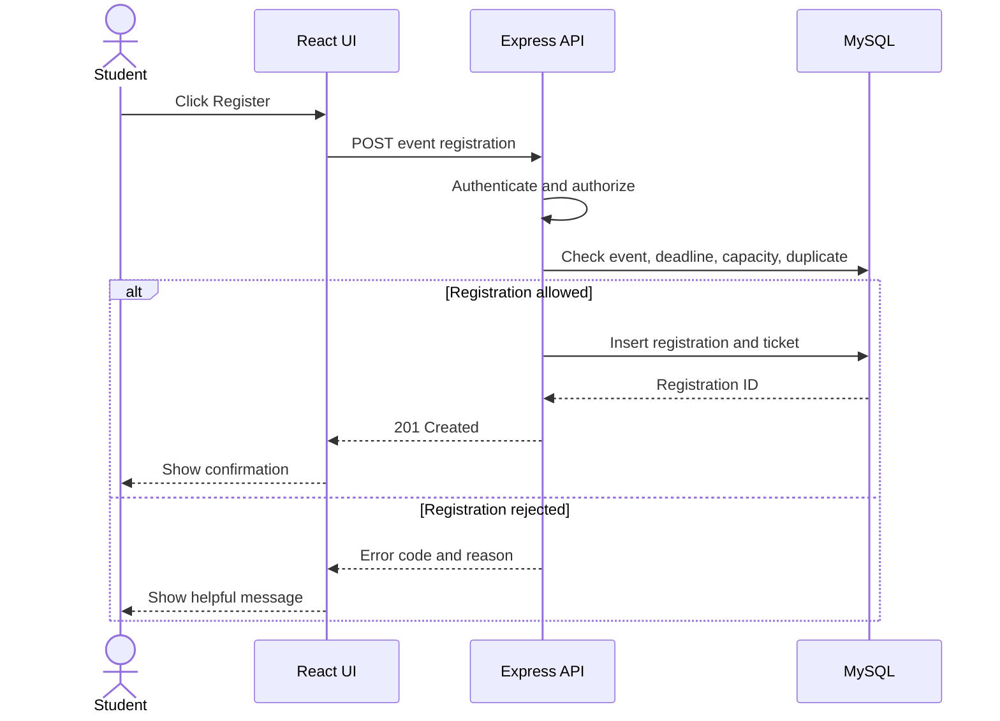

# Software Requirements Specification (SRS)
## UniEvent — University Event Management and Registration System

**Version:** 1.0 | **Status:** Proposed 

## 1. Introduction

### 1.1 Purpose
This SRS defines testable functional and non-functional requirements for UniEvent. It is intended for the development team, supervisor, and testers.

### 1.2 Scope
The web application supports Students, Event Organizers, and Administrators. It provides event discovery, event creation and approval, registration, attendance, notifications, certificates, feedback, and reports.

### 1.3 Terms

| Term | Definition |
|---|---|
| Event | University activity with a schedule, venue, organizer, and registration rules |
| Registration | Record linking a student to an event |
| Attendance | Check-in record for a valid registration |
| RBAC | Role-Based Access Control |
| QR ticket | Digital ticket containing/referencing a unique token |

## 2. Overall Description

### 2.1 Product Architecture

### 2.2 User Classes

| User | Expected use |
|---|---|
| Student | Search events, register, view own tickets and certificates |
| Organizer | Create events, manage registrations and attendance |
| Administrator | Approve events, manage users/categories, view reports |

### 2.3 Operating Environment
- Modern desktop or mobile browser.
- React.js frontend.
- Node.js and Express.js backend.
- MySQL database.
- Git/GitHub, VS Code, and Postman for development/testing.

### 2.4 Constraints
- Protected operations must be authorized on the backend.
- Passwords must be hashed, never stored as plaintext.
- Secrets must be stored in environment variables.
- Capacity and duplicate-registration rules must be enforced consistently.
- External payment and messaging integrations are not required for the initial release.

## 3. Functional Requirements

### 3.1 Accounts
- **SRS-FR-001:** Users can create accounts with required information.
- **SRS-FR-002:** Users can sign in with valid credentials.
- **SRS-FR-003:** Passwords are stored as secure hashes.
- **SRS-FR-004:** Signed-in users can sign out.
- **SRS-FR-005:** Protected actions require appropriate role permissions.
- **SRS-FR-006:** Users can view/update permitted profile fields.

### 3.2 Event Discovery
- **SRS-FR-007:** The system lists published events.
- **SRS-FR-008:** Event details include description, category, date, time, venue, organizer, capacity, and deadline.
- **SRS-FR-009:** Users can search by keyword.
- **SRS-FR-010:** Users can filter by category, date, organizer, and venue.

### 3.3 Event Management
- **SRS-FR-011:** Organizers can create events.
- **SRS-FR-012:** Organizers can edit/cancel events they own, subject to rules.
- **SRS-FR-013:** Newly submitted events enter pending review.
- **SRS-FR-014:** Admins can approve, reject, or request changes.
- **SRS-FR-015:** Event status and relevant timestamps are recorded.
- **SRS-FR-016:** Unapproved events are not shown as published.

### 3.4 Registration
- **SRS-FR-017:** Signed-in students can register while registration is open.
- **SRS-FR-018:** Duplicate registration for the same student/event is prevented.
- **SRS-FR-019:** Registration after the deadline is rejected.
- **SRS-FR-020:** Registration is rejected when capacity is full.
- **SRS-FR-021:** Each registration receives a unique reference.
- **SRS-FR-022:** Students can view and, when permitted, cancel their registrations.
- **SRS-FR-023:** Organizers can view participant lists for their events.

### 3.5 Tickets and Attendance
- **SRS-FR-024:** The system should provide a digital ticket or unique QR token.
- **SRS-FR-025:** Authorized organizers can validate tickets and record attendance.
- **SRS-FR-026:** Duplicate attendance records are prevented.
- **SRS-FR-027:** Manual ticket lookup is available if QR scanning fails.

### 3.6 Notifications, Certificates, and Feedback
- **SRS-FR-028:** Successful registration creates an in-app notification.
- **SRS-FR-029:** Organizers can publish announcements for their events.
- **SRS-FR-030:** Registered participants are notified of important changes/cancellations.
- **SRS-FR-031:** Organizers can identify certificate-eligible participants.
- **SRS-FR-032:** Certificates have unique numbers and issue dates.
- **SRS-FR-033:** Students can view/download their certificates.
- **SRS-FR-034:** Eligible participants can submit feedback after an event.
- **SRS-FR-035:** Duplicate feedback is prevented unless editing is explicitly supported.

### 3.7 Administration
- **SRS-FR-036:** Admins can manage user status and roles.
- **SRS-FR-037:** Admins can manage event categories.
- **SRS-FR-038:** Admins can view system-wide statistics.
- **SRS-FR-039:** Important administrative actions are logged.

## 4. External Interfaces

### User Interface
Pages include homepage, event listing/search, event details, login/register, student dashboard, organizer dashboard, admin dashboard, event editor, attendance check-in, tickets, certificates, and feedback.

### Software Interfaces

| Interface | Purpose |
|---|---|
| React ↔ Express API | Requests and responses |
| Express ↔ MySQL | Persistent data |
| Backend ↔ file storage | Posters and certificates |
| QR scanner ↔ attendance API | Ticket validation and check-in |

Use HTTPS in deployment, JSON for API data, and validate uploaded file type and size.

## 5. Data Requirements

| Entity | Important fields |
|---|---|
| User | user_id, name, email, password_hash, role, status |
| Event | event_id, organizer_id, category_id, title, event_date, times, venue, capacity, deadline, status |
| Category | category_id, category_name |
| Registration | registration_id, event_id, student_id, registered_at, status |
| Ticket | ticket_id, registration_id, qr_token, status |
| Attendance | attendance_id, registration_id, check_in_time, checked_by |
| Notification | notification_id, user_id, title, message, is_read |
| Certificate | certificate_id, event_id, student_id, certificate_number, issue_date |
| Feedback | feedback_id, event_id, student_id, rating, comments |

### Conceptual ER Diagram

## 6. Non-Functional Requirements
- **NFR-001 Security:** Validate authentication and authorization on protected endpoints.
- **NFR-002 Privacy:** Return only role-appropriate data.
- **NFR-003 Performance:** Common search/list requests should be responsive for expected project load.
- **NFR-004 Reliability:** Capacity and registration updates must avoid overbooking.
- **NFR-005 Usability:** Core workflows should be easy to understand.
- **NFR-006 Compatibility:** Support current common desktop/mobile browsers.
- **NFR-007 Maintainability:** Use modular code and documented APIs.
- **NFR-008 Accessibility:** Use semantic elements, keyboard controls, labels, and readable contrast.
- **NFR-009 Backup:** Back up the database before major deployment changes.

## 7. Use Case Diagram

## 8. Registration Sequence Diagram

## 9. Business Rules
1. Only published events accept registrations.
2. One active registration per student/event.
3. Registration must pass deadline and capacity checks.
4. Capacity checks and insertion should be transaction-safe.
5. Organizers may manage only their own events unless authorized otherwise.
6. Only admins approve/reject events.
7. Attendance requires a valid registration and can be recorded once.
8. Certificates follow defined eligibility rules.
9. Cancellation should trigger participant notifications.

## 10. Error Handling
Provide clear messages for invalid credentials, duplicate registration, closed registration, full capacity, cancelled event, unauthorized access, invalid fields, invalid uploads, and server/database failures. Do not expose stack traces in production.

## 11. Testing and Traceability

| Area | Verification |
|---|---|
| Authentication | Valid/invalid login and protected-route tests |
| Roles | Student denied access to admin endpoints |
| Events | Create, edit, submit, approve, reject |
| Registration | Duplicate, deadline, and capacity boundary tests |
| Attendance | Invalid ticket and duplicate check-in tests |
| Certificates/feedback | Eligibility and duplicate submission tests |

## 12. Acceptance Criteria
The initial system is acceptable when account, event, approval, search, and registration workflows work end-to-end, and role, duplicate, deadline, and capacity checks pass.

## 13. Conclusion
This SRS establishes a testable baseline for UniEvent. Requirements can be refined with supervisor feedback, and implementation changes should remain aligned with documented tests.
