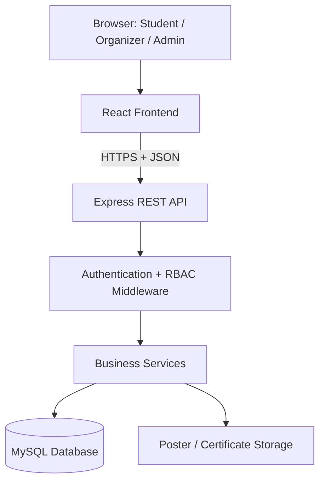
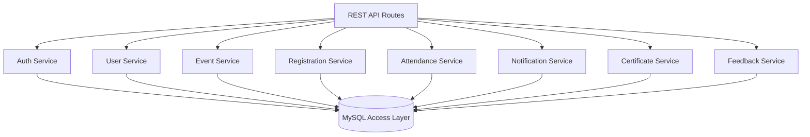
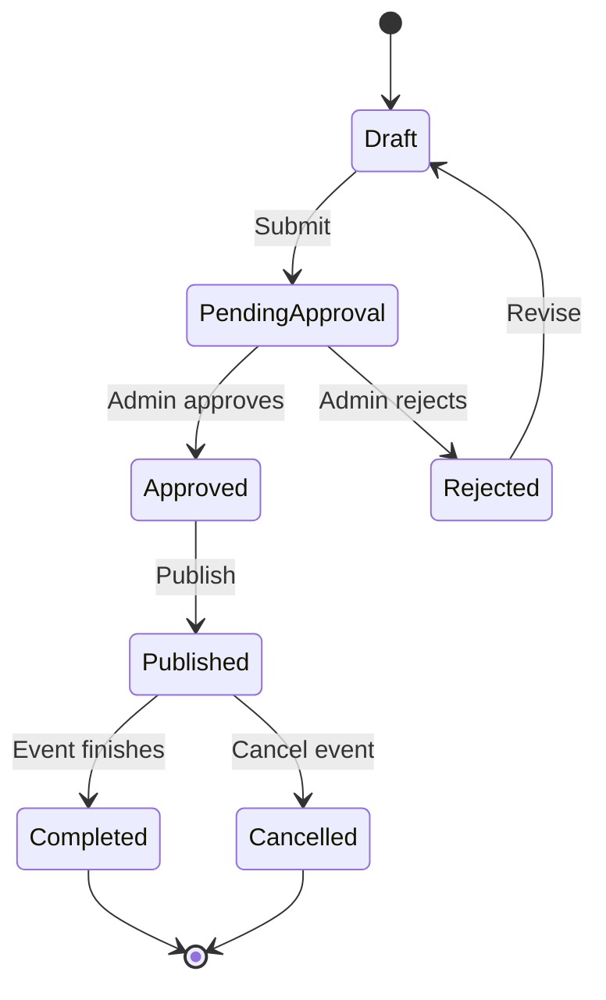
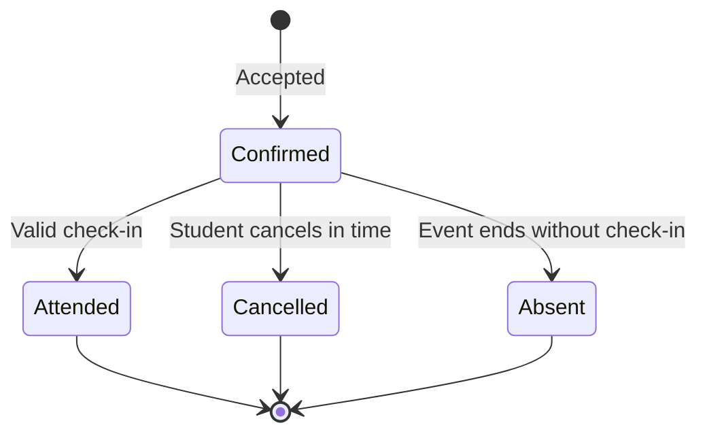
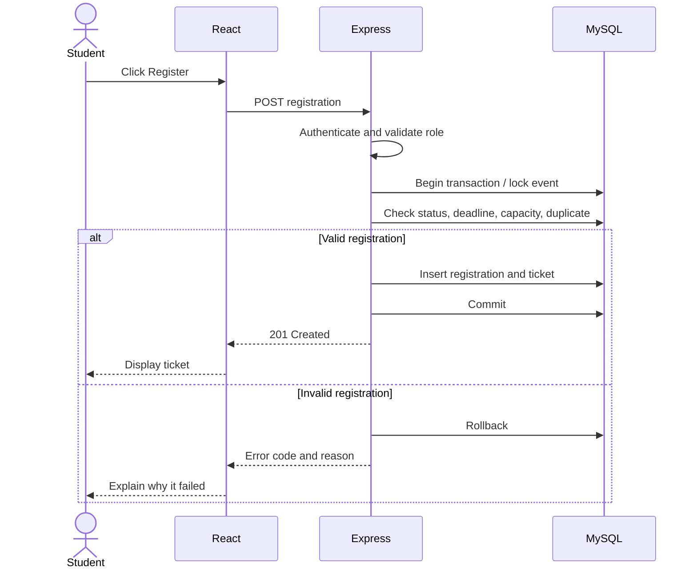

# Technical Design Document (TDD)
## UniEvent — University Event Management and Registration System

**Version:** 1.0 | **Status:** Proposed technical design 

## 1. Purpose and Design Goals
This document describes the proposed architecture, modules, database design, API conventions, security, and implementation plan.

Goals:
- Separate frontend, backend, and database responsibilities.
- Enforce authentication and authorization on the server.
- Prevent duplicate registrations and overbooking.
- Keep modules maintainable and testable.
- Support later QR attendance, certificates, notifications, and analytics.

## 2. Technology Stack

| Layer | Technology | Responsibility |
|---|---|---|
| Frontend | React.js | Pages, forms, dashboards |
| Styling | Tailwind CSS or CSS modules | Responsive UI |
| Routing | React Router | Navigation |
| API client | Axios or fetch | HTTP requests |
| Backend | Node.js + Express.js | REST API and business logic |
| Database | MySQL | Relational persistence |
| Authentication | JWT or secure sessions | Identify signed-in users |
| Password hashing | bcrypt | Store password hashes |
| Testing | Postman + automated tests | API/workflow testing |
| Version control | Git/GitHub | Change history |

Choose one authentication approach for the final implementation and use it consistently.

## 3. High-Level Architecture



### Responsibilities
- **Frontend:** Render pages, perform basic usability validation, and show API results.
- **API:** Validate requests, authenticate users, authorize actions, and return consistent responses.
- **Services:** Enforce event lifecycle, registration, capacity, attendance, and certificate rules.
- **Database:** Store relational application data with constraints.
- **File storage:** Store validated posters and generated certificates.

## 4. Component Design



Recommended backend layers:
1. **Routes:** Map HTTP paths to controllers.
2. **Middleware:** Authenticate, authorize, validate input, handle errors.
3. **Controllers:** Translate HTTP requests into service calls.
4. **Services:** Implement business rules and transaction boundaries.
5. **Repositories/data access:** Execute parameterized SQL.
6. **Utilities:** Ticket tokens, certificate IDs, date helpers, logging.

## 5. Suggested Folder Structure

```text
university-event-management/
├── frontend/
│   └── src/
│       ├── components/
│       ├── pages/
│       ├── layouts/
│       ├── routes/
│       ├── services/
│       ├── context/
│       ├── hooks/
│       └── assets/
├── backend/
│   └── src/
│       ├── config/
│       ├── routes/
│       ├── controllers/
│       ├── services/
│       ├── repositories/
│       ├── middleware/
│       ├── validators/
│       └── utils/
├── database/
│   ├── schema.sql
│   └── seed.sql
├── docs/
│   ├── PRD.md
│   ├── SRS.md
│   └── TDD.md
├── .env.example
├── .gitignore
└── README.md
```

## 6. Database Design

| Table | Purpose |
|---|---|
| users | Account, profile, role, status |
| categories | Event categories |
| events | Event information and state |
| registrations | Student-event relationship |
| tickets | Unique ticket token |
| attendance | Check-in record |
| notifications | User notifications |
| announcements | Event updates |
| certificates | Certificate issue records |
| feedback | Post-event ratings/comments |

### Data constraints
- Unique `users.email`.
- Unique `(event_id, student_id)` in registrations.
- Unique ticket tokens and certificate numbers.
- Foreign keys for related records.
- Positive event capacity and rating range checks where supported.
- Index event status/date/category and registration event ID.

### Registration transaction
1. Begin a database transaction.
2. Lock the event row or use another concurrency-safe capacity strategy.
3. Validate publication state and registration deadline.
4. Check current confirmed registrations against capacity.
5. Insert registration and ticket.
6. Commit; roll back if any validation or insert fails.

A unique database constraint on `(event_id, student_id)` is still required.

## 7. API Design

Base path: `/api`

### Authentication and profile

| Method | Endpoint | Access | Purpose |
|---|---|---|---|
| POST | `/auth/register` | Public | Create account |
| POST | `/auth/login` | Public | Sign in |
| POST | `/auth/logout` | Signed-in user, if supported by auth design | Sign out/invalidate session |
| GET | `/users/me` | Signed-in user | View own profile |
| PATCH | `/users/me` | Signed-in user | Update allowed profile fields |

### Events

| Method | Endpoint | Access | Purpose |
|---|---|---|---|
| GET | `/events` | Public | List published events and filters |
| GET | `/events/:id` | Public if published / authorized otherwise | Event details |
| POST | `/events` | Organizer | Create event for review |
| PATCH | `/events/:id` | Owner organizer or admin | Edit event |
| POST | `/events/:id/submit` | Event owner | Submit for approval |
| POST | `/admin/events/:id/approve` | Admin | Approve event |
| POST | `/admin/events/:id/reject` | Admin | Reject/request changes |
| POST | `/events/:id/cancel` | Owner organizer or admin | Cancel event |

### Registration and attendance

| Method | Endpoint | Access | Purpose |
|---|---|---|---|
| POST | `/events/:id/registrations` | Student | Register |
| GET | `/users/me/registrations` | Student | Own registrations |
| DELETE | `/registrations/:id` | Owner, subject to rules | Cancel registration |
| GET | `/registrations/:id/ticket` | Owner or authorized staff | View ticket |
| POST | `/events/:id/attendance/check-in` | Event organizer/admin | Validate ticket and check in |
| GET | `/events/:id/registrations` | Event organizer/admin | Participant list |

### Other modules

| Method | Endpoint | Access | Purpose |
|---|---|---|---|
| GET | `/users/me/notifications` | Signed-in user | List notifications |
| PATCH | `/notifications/:id/read` | Notification owner | Mark as read |
| POST | `/events/:id/announcements` | Event organizer | Publish announcement |
| POST | `/events/:id/feedback` | Eligible participant | Submit feedback |
| GET | `/users/me/certificates` | Student | List own certificates |
| GET | `/admin/reports/summary` | Admin | Summary statistics |

All endpoints must validate payloads, authentication, role, and resource ownership.

## 8. API Response Format

Success:

```json
{
  "success": true,
  "data": {
    "registrationId": 125,
    "status": "confirmed"
  }
}
```

Error:

```json
{
  "success": false,
  "error": {
    "code": "EVENT_CAPACITY_REACHED",
    "message": "Registration is closed because the event is full."
  }
}
```

Use appropriate HTTP status codes, such as 200, 201, 400, 401, 403, 404, and 409.

## 9. Security Design
- Hash passwords with bcrypt or an equivalent password-hashing algorithm.
- Validate input on the server.
- Use parameterized SQL queries.
- Enforce role and resource ownership checks in middleware/services.
- Keep secrets in environment variables; commit only `.env.example`.
- Use HTTPS in deployment.
- Restrict uploaded file types and sizes; generate safe filenames.
- Never expose password hashes or private tokens in responses.
- Rate-limit login where practical.
- Use secure cookie settings if cookie-based sessions are chosen.
- Log significant admin actions without logging credentials.

## 10. Frontend Pages

| Page | Main content |
|---|---|
| Home | Introduction and upcoming events |
| Events | Search, filters, event cards |
| Event details | Description, schedule, venue, capacity, register action |
| Login/Register | Validated account forms |
| Student dashboard | Registrations, tickets, notifications, certificates |
| Organizer dashboard | Owned events, counts, management actions |
| Event editor | Event fields and poster upload |
| Attendance | QR scan/manual lookup and result |
| Admin dashboard | Pending approvals, users, categories, reports |
| Feedback | Rating and comments |

## 11. State Models

### Event state



Registration closure may be derived from deadline/capacity rather than stored as an event state; choose one approach consistently.

### Registration state



## 12. Registration Sequence Diagram



## 13. Error Handling and Logging
- Use centralized Express error middleware.
- Return stable error codes and helpful messages.
- Log unexpected errors with a request identifier.
- Do not return stack traces or database details in production.
- Audit event approval, cancellation, and attendance corrections.

## 14. Testing Strategy

| Level | Examples |
|---|---|
| Unit | Capacity/deadline rules and role helpers |
| API | Login, event creation, approval, registration |
| Integration | API with MySQL constraints and transactions |
| Security | Unauthorized access, invalid tokens, injection checks |
| Boundary | Full capacity, deadline boundary, duplicate registration |
| UI | Form validation, responsive layout, error/success messages |
| Acceptance | Student, organizer, and admin end-to-end flows |

## 15. Configuration and Deployment
Suggested `.env.example` keys:

```text
PORT=5000
DATABASE_URL=
JWT_SECRET=
FRONTEND_URL=
UPLOAD_STORAGE_PATH=
```

Do not commit real secrets. Add `.env` to `.gitignore`. Deployment should configure HTTPS, database credentials, CORS, file storage, backups, and error monitoring.

## 16. Implementation Order
1. Repository and database schema.
2. Authentication and role middleware.
3. Event CRUD and admin approval.
4. Search and filters.
5. Registration with unique constraints and capacity checks.
6. Dashboards and participant lists.
7. Tickets and attendance.
8. Notifications and announcements.
9. Certificates and feedback.
10. Analytics, testing, documentation, and deployment.

## 17. Decisions to Confirm
- JWT versus secure cookie-based sessions.
- Local versus hosted file storage.
- Whether organizer accounts need admin approval.
- Certificate eligibility rules.
- Whether participant export is required.

## 18. Conclusion
This TDD provides a modular starting architecture for UniEvent. Prioritize server-side authorization, database integrity, safe registration transactions, and incremental delivery.
